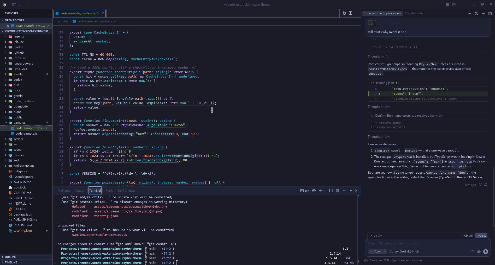
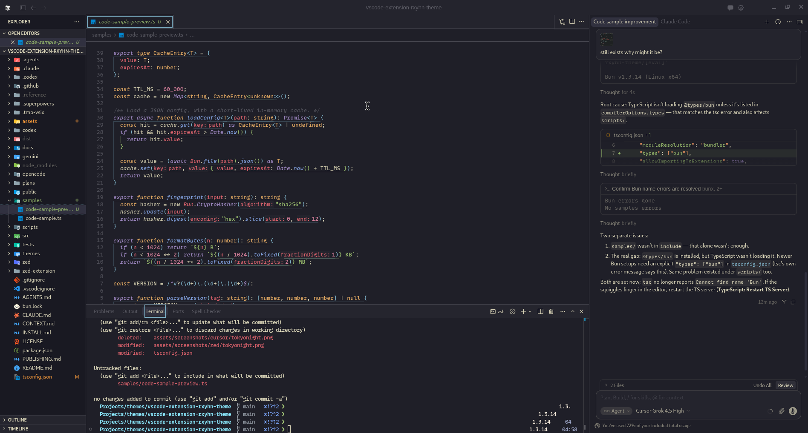
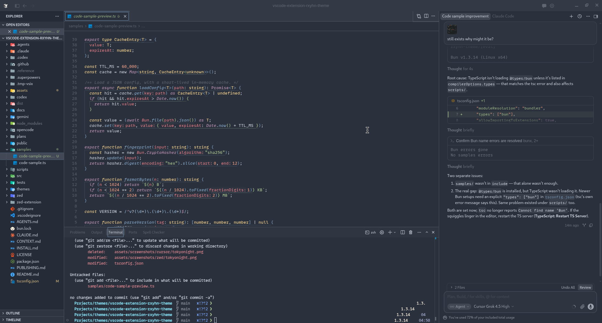
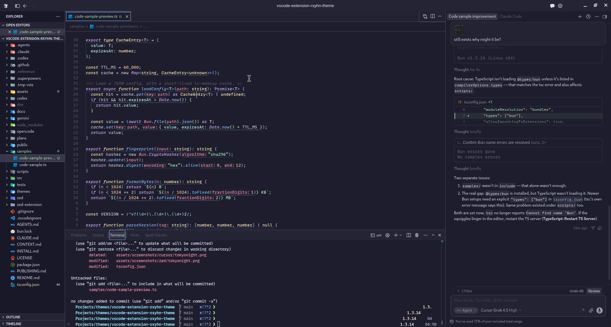
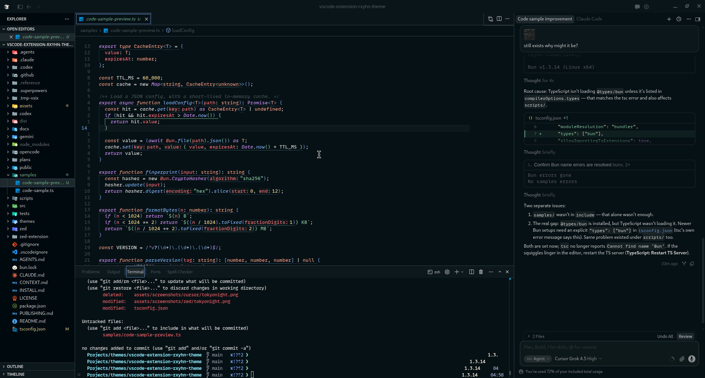
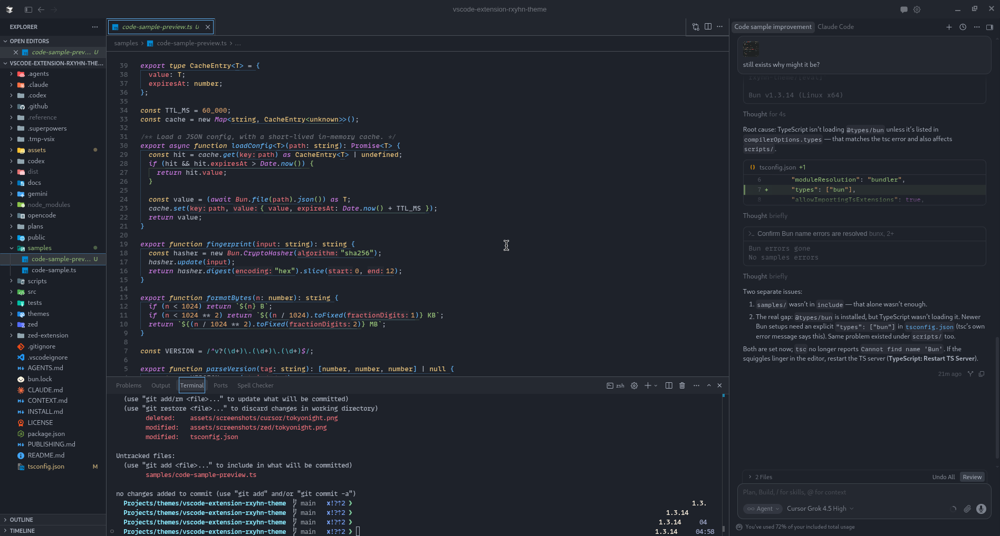
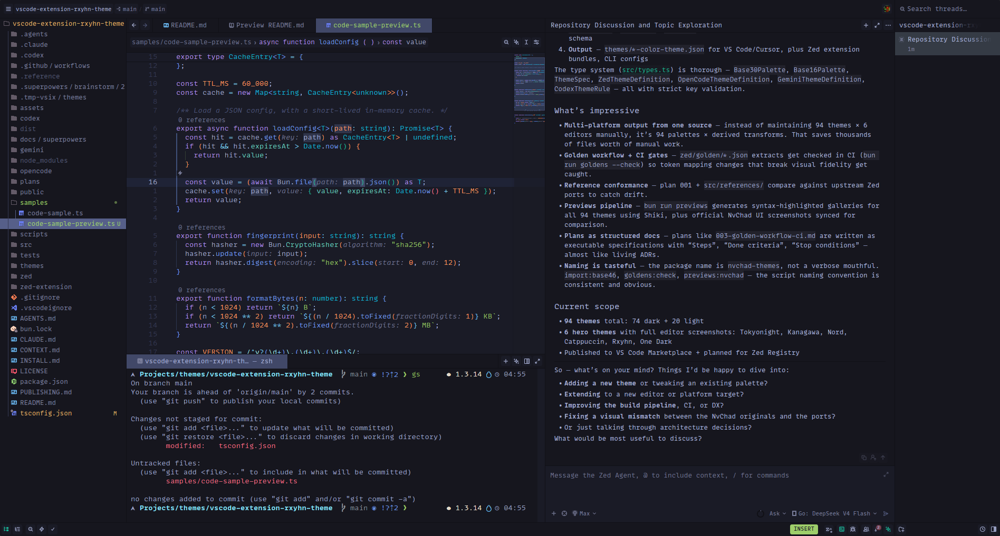
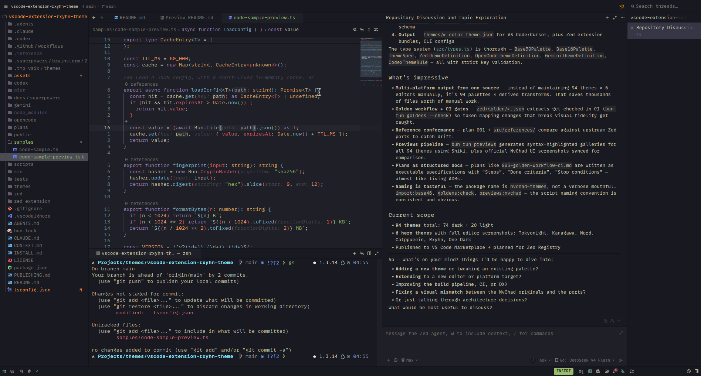
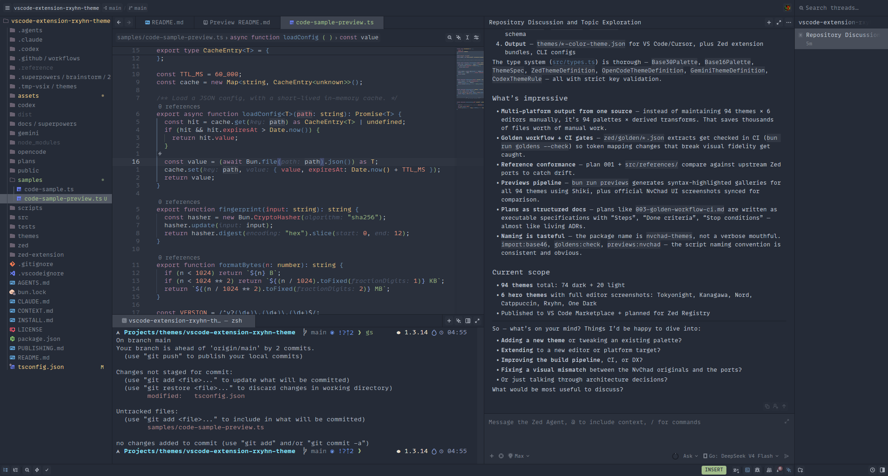
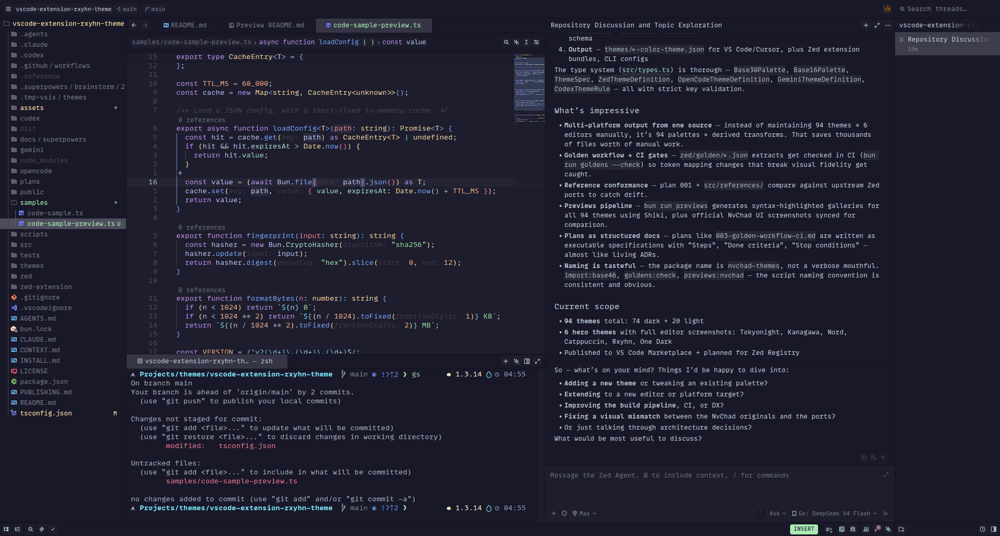

# NvChad Themes

The 94 NvChad base46 themes for VS Code, Cursor, and Zed, with matching theme files for OpenCode, Gemini CLI, and Codex.

[](https://github.com/KitsuneKode/nvchad-themes/actions/workflows/ci.yml)
[](https://github.com/KitsuneKode/nvchad-themes/releases/latest)
[](./LICENSE)

## Install

| Platform | Install path |
|----------|--------------|
| VS Code / Cursor | Download the `.vsix` from the [latest release](https://github.com/KitsuneKode/nvchad-themes/releases/latest), then use **Install from VSIX…** |
| Zed, after registry publication | Open Zed Extensions, search **NvChad Themes**, and install it |
| Zed, before registry publication | Download the Zed ZIP from the [latest release](https://github.com/KitsuneKode/nvchad-themes/releases/latest), extract it, and use **`zed: install dev extension`** |
| Zed user theme | Download the user JSON from the [latest release](https://github.com/KitsuneKode/nvchad-themes/releases/latest) and copy it to `~/.config/zed/themes/` |
| OpenCode / Gemini CLI / Codex | Use the files and instructions in [INSTALL.md](./INSTALL.md) |

Detailed automated and manual instructions: [INSTALL.md](./INSTALL.md).

## Previews

These are real 1280×800 editor screenshots for the six hero themes. The [screenshot guide](./assets/screenshots/README.md) explains how to refresh them after theme changes.

### Cursor / VS Code

| NvChad Tokyonight | NvChad Kanagawa |
| :---: | :---: |
|  |  |

| NvChad Nord | NvChad Catppuccin |
| :---: | :---: |
|  |  |

| NvChad Rxyhn | NvChad One Dark |
| :---: | :---: |
|  |  |

### Zed

| NvChad Tokyonight | NvChad Kanagawa |
| :---: | :---: |
|  |  |

| NvChad Nord | NvChad Catppuccin |
| :---: | :---: |
|  |  |

**Generated syntax gallery:** [all 94 previews](./assets/gallery/vscode/) · **NvChad reference gallery:** [nvchad.com/themes](https://nvchad.com/themes/)

## Theme list

<details>
<summary>All 94 theme IDs</summary>

**Dark:** `aquarium`, `ashes`, `aylin`, `ayu_dark`, `bearded-arc`, `carbonfox`, `catppuccin`, `chadracula`, `chadracula-evondev`, `chadtain`, `chocolate`, `darcula-dark`, `dark_horizon`, `decay`, `default-dark`, `doomchad`, `eldritch`, `embark`, `everblush`, `everforest`, `falcon`, `flexoki`, `flouromachine`, `gatekeeper`, `github_dark`, `gruvbox`, `gruvchad`, `hiberbee`, `horizon`, `jabuti`, `jellybeans`, `kanagawa`, `kanagawa-dragon`, `material-darker`, `material-deep-ocean`, `melange`, `midnight_breeze`, `mito-laser`, `monekai`, `monochrome`, `mountain`, `neofusion`, `nightfox`, `nightlamp`, `nightowl`, `nord`, `obsidian-ember`, `oceanic-next`, `onedark`, `onenord`, `oxocarbon`, `palenight`, `pastelDark`, `pastelbeans`, `penumbra_dark`, `poimandres`, `radium`, `rosepine`, `rxyhn`, `scaryforest`, `seoul256_dark`, `solarized_dark`, `solarized_osaka`, `starlight`, `sweetpastel`, `tokyodark`, `tokyonight`, `tomorrow_night`, `tundra`, `vesper`, `vscode_dark`, `wombat`, `yoru`, `zenburn`

**Light:** `ayu_light`, `blossom_light`, `catppuccin-latte`, `default-light`, `everforest_light`, `flex-light`, `flexoki-light`, `github_light`, `gruvbox_light`, `material-lighter`, `nano-light`, `oceanic-light`, `one_light`, `onenord_light`, `penumbra_light`, `rosepine-dawn`, `seoul256_light`, `solarized_light`, `sunrise_breeze`, `vscode_light`

</details>

## Development

Contributors need [Bun](https://bun.sh):

```bash
bun install
bun run build
bun test
bun run previews
bun run package
bun run verify
```

For release and Zed Registry publishing instructions, see [PUBLISHING.md](./PUBLISHING.md).

## Credits and license

Palettes: [NvChad/base46](https://github.com/NvChad/base46) v3.0. MIT licensed; see [LICENSE](./LICENSE).
